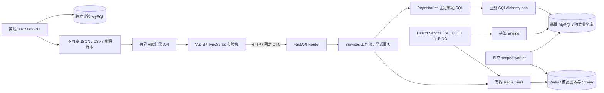
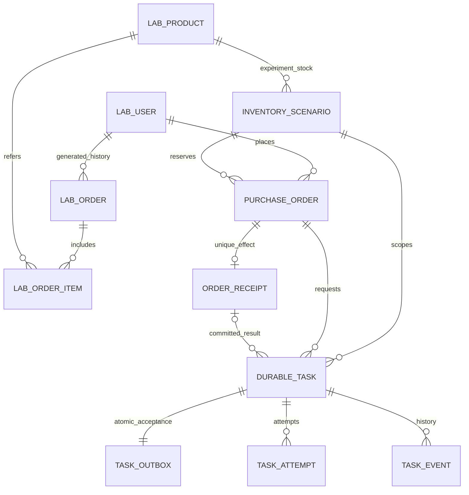
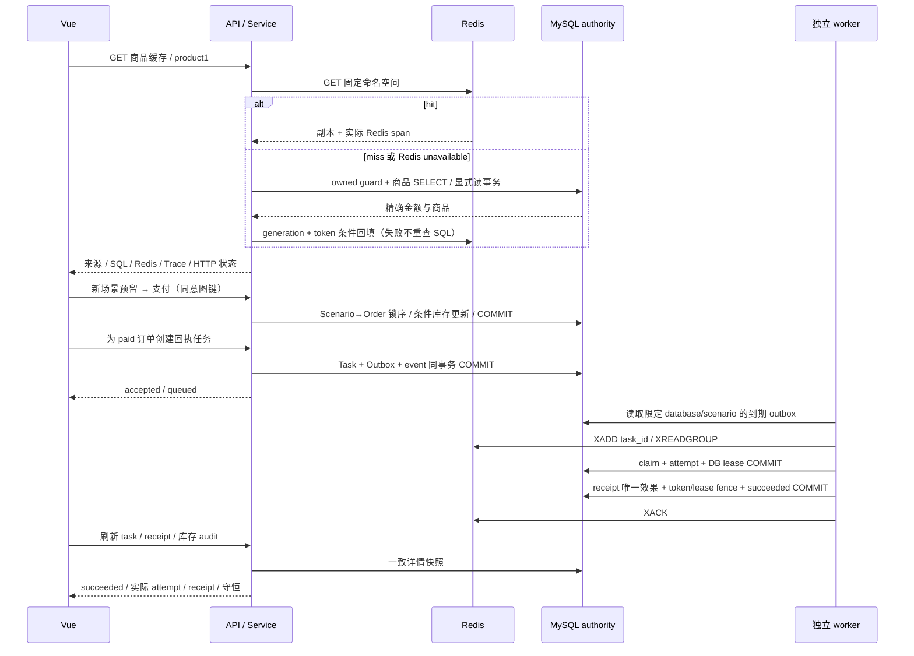

# High Concurrency Lab 最终系统说明

这是可在本机运行的模块化单体学习实验台：Vue 显示真实请求、数据库/Redis 操作、事务和历史性能证据，FastAPI 提供固定业务接口，独立 CLI 负责重型实验与可靠回执 worker。MySQL 是业务事实源，Redis 是缓存副本和可重复投递的运输层。没有微服务、自动分片或生产容量承诺。

## 交付与入口

| 阶段 | 页面与职责 | 审核合并 | 实际证据/操作 |
|---|---|---|---|
| 001–003 | `/`、`/trace`、`/database`、`/experiments`、`/pool`：基础探针、历史索引、教学模拟 | 保留已有实现 | [架构与边界](overview.md) |
| 004 | `/business`：真实商品/用户订单/明细与 SQL Trace | [PR6](https://github.com/wanglizhi9264/high-concurrency-lab/pull/6) | [指南](../guides/business-lab.md)、[报告](../experiments/004-real-business-trace/README.md) |
| 005 | `/load-tests`：Locust 真实完成/成功 RPS、错误、SQL/资源 | [PR7](https://github.com/wanglizhi9264/high-concurrency-lab/pull/7) | [指南](../guides/load-testing.md)、[报告](../experiments/005-real-load-testing/README.md) |
| 006 | `/cache-lab`：商品 Cache-Aside、TTL、失效与实际回源 | [PR8](https://github.com/wanglizhi9264/high-concurrency-lab/pull/8) | [指南](../guides/cache-lab.md)、[报告](../experiments/006-redis-cache-aside/README.md) |
| 007 | `/inventory-lab`：库存预留/支付/取消、幂等与审计 | [PR9](https://github.com/wanglizhi9264/high-concurrency-lab/pull/9) | [指南](../guides/inventory-lab.md)、[报告](../experiments/007-inventory-idempotency/README.md) |
| 008 | `/tasks`：持久任务、独立 worker、失败/重试/崩溃恢复 | [PR10](https://github.com/wanglizhi9264/high-concurrency-lab/pull/10) | [指南](../guides/worker-lab.md)、[报告](../experiments/008-reliable-receipt-worker/report.md) |
| 009 | `/scale-lab`：百万行索引/分页/分区/写入对照 | 独立 feature 分支，保护 CI 后 PR 合并 | [实测报告](../experiments/009-scale-comprehensive-lab/report.md)、[克隆验收](../guides/clean-clone.md) |

所有阶段使用 Specify→Plan→Tasks→Analyze→Implement→验证/审查→Converge；规格、任务、验证和收敛记录位于各自 `specs/`。001–008 历史 JSON/CSV 和 002 已测数据保持不变。009 的源码、原始记录与后续验收检查点分别明确标识，不给历史结果换源码身份。

## 结构与资源所有权



API lifespan 持有基础 Engine、可选业务 Engine/sessionmaker、Redis client；退出统一关闭。每次工作流创建自己的 Session/事务，不在并发任务间共享。健康探针直接 Engine.connect，查 `SELECT 1`、Redis `PING`，不进入业务 ORM Session。CLI worker 与实验 runner 拥有各自资源；HTTP 无启动进程、任意 SQL、任意脚本或任意 Redis key 的接口。应用启动不迁移、不造数。

基础 MySQL 默认 3306、Redis 默认 6379（本机开发配置 16379），业务库只允许 business/business_test。独立实验实例默认 13306，002 和 009 各自固定 allowlist/所有权/迁移上下文，绝不复用已测库做业务写入。新克隆另用项目、端口、卷和本地随机凭据。

```text
high-concurrency-lab/
├── .specify/memory/constitution.md   # 宪法 2.0.0 / 官方工作流
├── .agents/skills/speckit-*/         # Specify、Plan、Tasks、Analyze、Implement、Converge
├── specs/001-...009-*/              # 每阶段 SDD、验证、收敛
├── src/concurrency_lab/
│   ├── main.py / core/ / db/       # 配置、lifespan、pool、owned_session
│   ├── api/routes/ / schemas/      # HTTP 映射与窄类型边界
│   ├── services/ / repositories/   # 事务流程 / 固定 SQL
│   ├── domain/inventory.py         # 状态与审计不变量
│   ├── cache/                     # generation+lease 商品缓存、任务 Stream
│   ├── workers/                   # 独立 dispatcher / consumer CLI
│   ├── models/                    # commerce、inventory、tasks、独立 ScaleBase
│   ├── observability/             # 实际 monotonic span / request id
│   └── experiments/               # 002、业务数据、负载记录、009 scale
├── migrations/versions/           # 0001–0005，显式 Alembic
├── migrations/scale/              # 独立 scale001–003
├── frontend/src/                  # Vue views、窄 API/types、共享图/请求传输
├── frontend/tests/ / e2e/         # Vitest / 实际 Playwright 浏览器
├── scripts/                       # 显式 provision、验收、owned 实验启动器
├── benchmarks/locust/             # 子进程闭环 HTTP 工作负载
├── tests/unit/ / integration/     # 纯规则与真实 MySQL/Redis/故障
├── docs/architecture/decisions/   # ADR0001–0007
├── docs/database/ / guides/       # 已迁移 ER、运行/阅读指南
├── docs/experiments/              # 原始不可变证据 / 报告 / 截图
├── compose.yaml / compose.experiments.yaml
└── .github/workflows/             # 3 个正常保护 job + 手动重型实验
```

## 数据模型



生成历史 `lab_order` 与可写 `purchase_order` 分开。库存 CHECK 非负且 available+reserved+sold=initial；订单金额精确 DECIMAL，唯一幂等键+payload SHA；receipt UNIQUE(order_id) 防止重复业务效果。详细类型、索引、外键/约束见 [库存 ER](../database/inventory.md)、[任务 ER](../database/tasks.md)。

009 独立分析副本 `scale_order` / `scale_order_partitioned` 使用相同 PK(id,created_at)、完全一致逻辑数据，没有伪造业务 FK；三张独立空写探针比较索引维护。分区约束、所有权与数据 SHA 见 [009 ER](../database/scale.md)。没有把分析分区设计直接套在业务主表。

## 一次真实操作的调用链

1. 商品读取：浏览器 GET business/products/1 → Router → BusinessService 显式读事务 → 实际库名/ownership/ready 查询 → Repository 查询 lab_product → COMMIT → JSON Trace。明细接口固定查订单及 JOIN 明细两条业务 SQL；所有权 SQL 也计入观测。
2. 缓存读取：GET 缓存路由 → Redis 固定 key GET/有界 lease → hit 直接返回；miss 或 Redis 错误才进入上述 MySQL 路径。回填必须同时持有原 generation 与 lease token；invalidate 推进 generation 并撤销值/lease。MySQL 成功但发布失败不会重复已完成 SQL。
3. 库存写入：开关/参数 → Scenario→Order 锁序 → 唯一 INSERT/条件库存 UPDATE → 同一事务提交。1062 整体回滚后新事务判定同意图；1205/1213 整体回滚，同意图可重试。支付转移 reserved→sold，取消归还 available；历史 cancelled 不占库存。
4. 回执任务：paid 订单 → Task+Outbox+event 同事务受理 → 独立 dispatcher XADD task_id → consumer claim(token/DB UTC lease/attempt) 提交 → handler → receipt 唯一效果+最终 token/lease fence 同事务提交 → XACK。受理成功不等于执行成功，ACK 失败不撤销已提交效果；崩溃后恢复保留 abandoned attempt，耗时未知不补造。failed 保留，新任务链接旧任务重试。
5. 重型实验：显式 CLI guard → 空库 Alembic → 固定 seed 分批事务 → 流式实际 SHA → 基线 SQL/原始计划落盘 → 允许联合索引迁移 → 再保存证据 → 覆盖候选迁移 → 写探针/最终数据复核 → 只读 API/UI。任何失败保留部分证据，不清库重跑。

实际请求/响应、失败与耗时可逐项展开。业务 acquire 包含 pool 等待/建连/pre_ping，SQL span 包含驱动/网络/取数；浏览器 RTT、服务时间、嵌套 span 不能相加。Recorded、Live Trace、Simulation 使用不同标签和数据模型。



## 重要取舍与后续边界

| 决策 | 解决的问题与代价 | 依据 |
|---|---|---|
| 单体内按职责拆分，lifespan 持有资源 | 易追踪和测试；不提前引入服务治理 | 宪法、ADR0001 |
| 不可变证据与 Live/Simulation 分离 | 可复核结果；会保存较多原始文件 | ADR0002/0003 |
| 缓存 generation + lease 双 fence | 避免失效后旧值回填；Redis 故障可重复读 MySQL | [ADR0004](decisions/0004-product-cache.md) |
| Scenario→Order 锁序，数据库幂等/守恒 | 防超卖与重复效果；热点会竞争锁，需要预算/重试 | [ADR0005](decisions/0005-inventory.md) |
| MySQL outbox + Stream + 最终 lease fence | 抵抗消息丢失/重复与 worker 崩溃；运输仍是 at-least-once | [ADR0006](decisions/0006-reliable-worker.md) |
| 独立分析双表和空写探针 | 可比索引/分区，保留业务数据；不能直接推断生产存量写成本 | [ADR0007](decisions/0007-scale-partition-comparison.md) |

后续可在新的 SDD/Feature 中评估：持续且多次重复负载、真实更新/失效一致性、用户/时间倾斜数据、备份与恢复演练，以及有业务 SLA 后的分区/分片容量决策。任务保留、归档、权限控制与跨进程监控也需要明确新规格。以上是扩展方向，当前没有提前加入对应服务或宣称已验证。

## 分阶段实际结果与解释

005 的 15 秒短测中，10/50 用户无失败，100/500 用户在池 5 下分别出现 375/2227 次失败；500 用户完成 RPS 137.585 而成功 RPS 13.986，不能把失败吞吐当容量。改变池和节奏不是自动优化，全部原始 starts/requests/Locust CSV 与资源作用域留在报告。

006 功能验收中 bypass 五次产生五次商品 SQL；hot 五次全部命中且零 MySQL SQL；六并发冷读取实际为一次 miss、五次 hit、一次商品查询。TTL 从实测 934ms 到不存在，值内存估算 264 bytes。不是并发容量测试。

007：20 个不同意图争库存 5，实际创建 5、拒绝 15；10 次同意图为一次创建、九次重放。支付/取消及真实死锁/锁超时验证守恒与回滚恢复。

008：真实 retry、超时终态、新任务重试、child exit70、lease 过期后恢复全部留下数据库/进程证据。最后队列 XLEN=2、pending=0、lag=0；这三个量含义不同。一次成功 receipt 不证明消息 exactly-once。

009：百万普通表深页 P50 433.140→147.355→138.449ms；已知游标 154.347→4.494→4.694ms，随机游标定位单列另计。用户投影实际访问 954→20→20 行；覆盖阶段有真实 using_index/TREE。七月范围分区裁剪 p3，但覆盖阶段普通表 30.552ms 优于分区表 42.982ms。单列/覆盖空写探针分别约 25321/23045 rows/SQL秒，二级索引分配估算 53.1MB→77.8MB。完整原始值、资源、skip-scan 解析未知与混杂限制见 [009 报告](../experiments/009-scale-comprehensive-lab/report.md)。

## 运行、验收和学习

从 [README](../../README.md) 配置本地 ignored.env、frozen 安装、启动基础依赖；按 [业务指南](../guides/business-lab.md) 显式初始化独立业务库，再按 [库存指南](../guides/inventory-lab.md)/[worker 指南](../guides/worker-lab.md) 显式升 0005 并开启写开关。开发 API 18002、前端 5173；每种实验页面给出具体请求、目标库/表、实际 SQL 与成功/失败反馈。

完整独立重建运行 `uv run python scripts/verify_end_to_end.py`；它使用新 Git 克隆、新依赖安装、新端口/卷/凭据，实际执行所有业务、短 Locust、故障恢复、paid→receipt、质量/真实集成/浏览器流程，结束只 stop 自有资源，保留卷和原始证据。实际运行编号及结果在 009 报告与 validation 中记录，失败不会伪装为完成。

正常检查：`uv run python scripts/verify.py`、`uv run pytest tests/integration`（相应显式 opt-in 与隔离库）、`uv run python scripts/verify_index_lab.py --verify-only`、`uv run python scripts/verify_scale_lab.py`；frontend 下 `npm run check`、`npm run test`、`npm run build`、`npm run test:e2e`。正常 CI 保持 quality/integration/frontend 三个保护 job；百万/千万只允许独立手动 workflow/CLI。

阅读顺序见 [源码指南](../guides/source-reading.md)。人工重点掌握 SQL 访问路径/最左前缀/覆盖与 ICP、稳定排序和游标、Session 与事务隔离/current read、数据库唯一约束与幂等、缓存双 fence、outbox/at-least-once/lease 与最终 fence、百分位/错误率/资源边界。没有测量跨片与持续生产工作负载，不建议仅凭行数加入分库分表。
