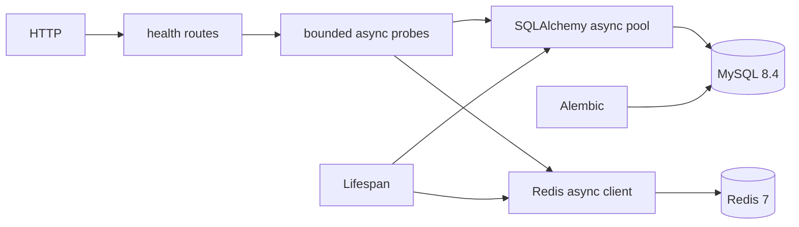

# Architecture Overview

main.py lifespan 创建 Resources（配置、Engine、Redis、sessionmaker），退出关闭。api/routes/health.py 只负责 HTTP；services/health.py 调用 SELECT 1/PING，asyncio.timeout 包含池等待和命令时间，两项 gather 并发。默认每项 2 秒，非硬实时保证。失败仅返回 unavailable。
core/config.py 读取环境变量/.env，密码为 SecretStr，validation 不显示输入。db/session.py 提供每请求独立 AsyncSession DI；写操作必须显式 session.begin()，异常回滚，关闭 session。SQLAlchemy URL.create 安全编码特殊字符密码。
MySQL 是未来业务事实源；Redis 当前只有连通性验证，无缓存/锁/队列。一进程池上限为 pool_size + max_overflow=10，多 worker 时乘 worker 数；Redis 每进程默认最多 10 个连接。pool_recycle=1800 应小于服务器 wait_timeout。
models/marker.py 仅迁移验证；没有运行时 create_all。迁移独立于应用启动，使用 NullPool。
未来按 feature 引入业务 services/repositories/schemas，当前没有职责则不建空层。性能改造必须对照环境、基线和尾延迟，不能将异步视作必然更快。
