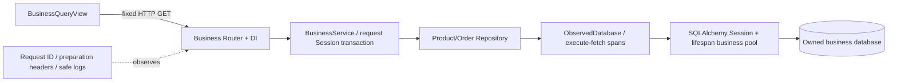
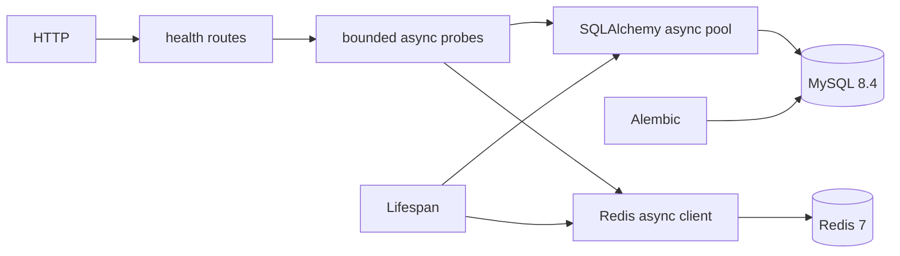

# Architecture Overview
## 004 business extension
Original diagrams below describe foundation health. The opt-in business path is separate:

Responsibilities, exact observation boundaries and safety decisions: [ADR0002](decisions/0002-business-lab.md), [runbook](../guides/business-lab.md).001/003health traces remain separate;002reads immutable JSON. No businessRedis/queue yet.

main.py lifespan 创建 Resources（配置、Engine、Redis、sessionmaker），退出关闭。api/routes/health.py 只负责 HTTP；services/health.py 调用 SELECT 1/PING，asyncio.timeout 包含池等待和命令时间，两项 gather 并发。默认每项 2 秒，非硬实时保证。失败仅返回 unavailable。
core/config.py 读取环境变量/.env，密码为 SecretStr，validation 不显示输入。db/session.py 提供每请求独立 AsyncSession DI；写操作必须显式 session.begin()，异常回滚，关闭 session。SQLAlchemy URL.create 安全编码特殊字符密码。
MySQL 是未来业务事实源；Redis 当前只有连通性验证，无缓存/锁/队列。一进程池上限为 pool_size + max_overflow=10，多 worker 时乘 worker 数；Redis 每进程默认最多 10 个连接。pool_recycle=1800 应小于服务器 wait_timeout。
models/marker.py 仅迁移验证；没有运行时 create_all。迁移独立于应用启动，使用 NullPool。
未来按 feature 引入业务 services/repositories/schemas，当前没有职责则不建空层。性能改造必须对照环境、基线和尾延迟，不能将异步视作必然更快。

## 002 实验模块
experiments/ 下 safety.py 是库名/所有权保护，dataset.py 负责有界批量事务，queries.py 定义固定查询与计划解析，runner.py 保存真实测量，index_baseline.py 为 CLI。使用独立 mysql-experiment 实例与 volume，默认13306；不借用应用池，不新增 HTTP 路由。
commerce.py 中四个关系模型只服务数据/索引实验。Alembic0002提供基线结构，0003新增查询索引；ORM metadata 表示 head。迁移配置支持程序传入 database_url，仍由 Alembic管理全部DDL。安全元数据表仅保存实验身份与 loading/ready状态。

## 003 可视化入口
Vue3 SPA位于frontend/，以只读DTO API访问架构、经过Pydantic校验的002证据和健康观测。services/visualization.py仅读取固定目录及固定文件名；schemas/visualization.py定义完整证据/响应边界。services/tracing.py为单请求monotonic事件记录器，原health Service只增加可选回调，旧API响应不变。
真实健康路径直接Engine.connect，不经过Session；启动记录是lazy对象创建；frontend的浏览器往返与服务端时钟分开。池模拟完全在客户端，真实pool快照只读现有gauges。无SQL写入API、无新Schema/缓存/队列。详见 docs/guides/visualization-platform.md。
