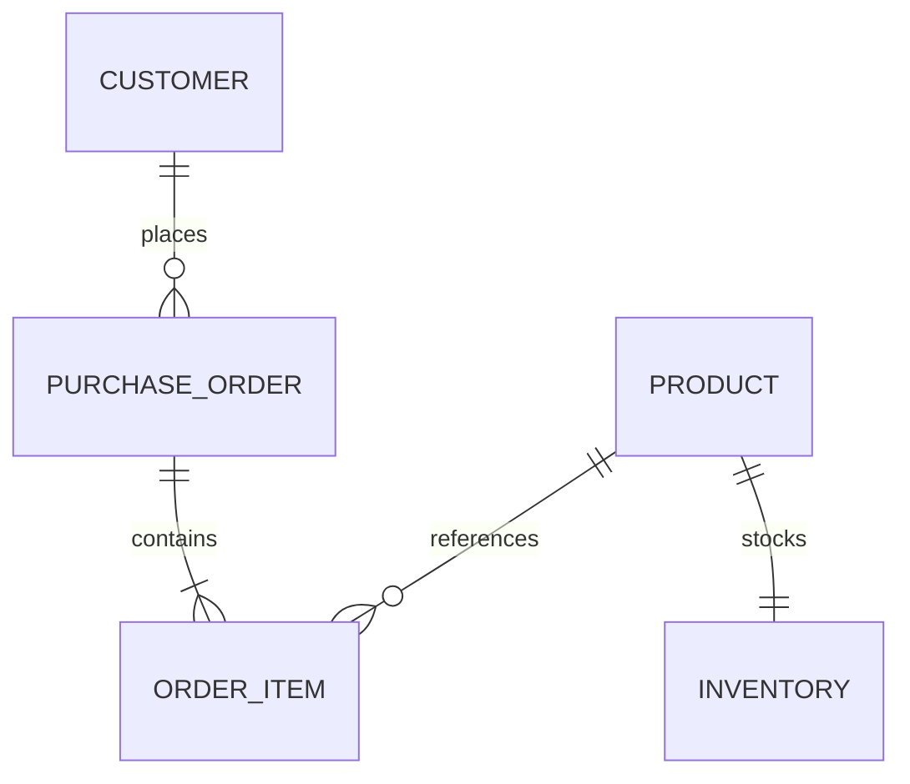

# Database Design
## 当前已迁移
lab_marker：id BIGINT AUTO_INCREMENT PRIMARY KEY，仅验证 Alembic；无业务数据、默认行或 API。alembic_version 为迁移工具内部表。InnoDB、utf8mb4。迁移脚本是当前 Schema 事实源。
## 原则
主键窄且稳定；金额使用 DECIMAL/整数最小币种单位，不使用浮点。时间统一 UTC，明确精度；字符串明确长度、字符集与排序语义。状态字段有约束或清晰枚举。不无理由使用 JSON 承载关系数据。
唯一性由唯一约束保证；联合索引顺序依据过滤/排序、选择性和最左前缀实验。索引会增加写放大，保留 EXPLAIN ANALYZE、数据规模、执行时间和索引大小。
写入使用短事务和显式 begin/commit，异常 rollback；隔离级别以 MySQL 实际值记录，后续事务实验再变更。避免跨请求共享 Session；外部副作用和数据库提交的一致性需单独设计。
## 未来规划（未实施）

初步字段：customer(id)、product(id,sku 唯一,price)、inventory(product_id 唯一,available,version)、purchase_order(id,customer_id,idempotency_key 唯一,status,total)、order_item(id,order_id,product_id,quantity,unit_price)。实际字段、外键、事务/库存策略必须在独立 Feature 指定，不属于当前迁移。
## 大表方向
先测百万/千万行、覆盖索引、游标分页与深 OFFSET；再比较分区裁剪、维护成本、分表路由与跨表事务。MySQL 分区唯一键限制和外键限制要按目标版本验证。不得先分库分表再寻找理由。

## 002 已实现的实验 Schema
先前“未来规划”描述的是完整订单业务（含库存、幂等和状态机），仍未实施。当前新增 lab_user/lab_product/lab_order/lab_order_item 作为数据与索引实验结构，另有 experiment_ownership/dataset安全元数据；无业务 API。详见 [当前ER和字段](../../specs/002-mysql-index-baseline/data-model.md)。
0002保留主键/唯一/FK支持索引，0003新增 email 与用户时间/全局时间索引。实验 CLI 只允许独立实例上的固定实验库，无清空选项。基础应用数据库仅在明确运行 Alembic upgrade后获得该结构，应用启动仍不建表。
