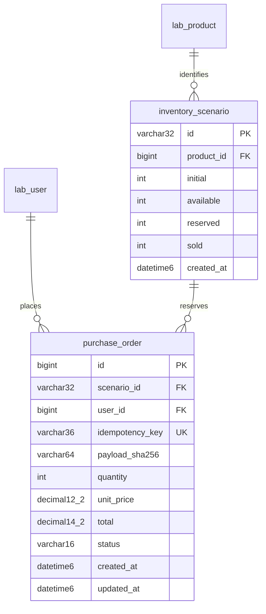

# 007 实际迁移的库存结构（Alembic0004）

既有002/004生成表保持不变。新增两张InnoDB表，只在明确迁移的业务库用于可写实验；金额使用DECIMAL，时间DATETIME(6)，标识UUID列使用ascii_bin匹配外键。

库存CHECK：数量非负，available+reserved+sold=initial。订单CHECK：1<=quantity<=100，单价非负且total=quantity×unit_price，状态为reserved/paid/cancelled。跨表数量一致性由事务工作流和独立audit验证，不伪装成跨表CHECK。

索引：inventory.product_id外键支持索引；purchase.idempotency_key唯一；purchase(scenario_id,status)支持场景外键/状态聚合；purchase.user_id支持用户外键。id为订单自增BIGINT主键。只有单商品订单，不提前设计多商品结算。

锁顺序统一Scenario→Order；预留条件UPDATE和终态库存转移都检查影响恰好1行。读取API使用普通RR快照，状态判断使用加锁后的current read。0004不修改lab_order和lab_order_item，002基线迁移仍固定0002/0003。
