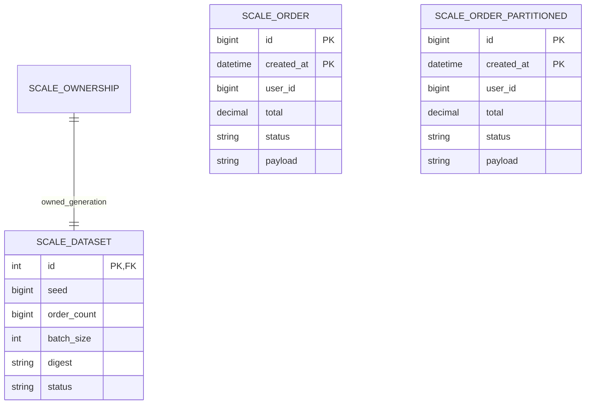

# 009分析Schema

独立`migrations/scale`上下文和`scale_alembic_version`，与全局0001–0005及002冻结迁移分离。`ScaleBase.metadata`不进入业务Base。显式CLI升级；应用启动无DDL。

两查询表逻辑数据相同，关系由流式SHA/精确计数/月份/id唯一校验，不画成不存在的业务FK。created_at DATETIME(6)，total DECIMAL(14,2)，合成user_id BIGINT，status合法集合，payload VARCHAR160，id/user/金额约束。PK(id,created_at)在普通/分区表一致。分区按2025季度RANGE COLUMNS再加p_future；业务外键与UNIQUE(id)不在这个分析模型中。

scale001单列ix_user；scale002替换ix_user_time(user_id,created_at,id)并加ix_time(created_at,id)；scale003替换ix_user_cover(user_id,created_at,id,total,status)。每阶段实际SHOW CREATE/INDEX和分配页估算在记录中，不能根据名字宣布覆盖。

三张写探针scale_write_single/composite/covering同列同PK，最终分别保留对应索引。它们从空表装载相同50k行，查询双表不追加。owner/dataset单例主键明确非自增，MySQL CHECK不可引用自增列。loading失败与部分DDL保留，不支持破坏性downgrade/reset。
