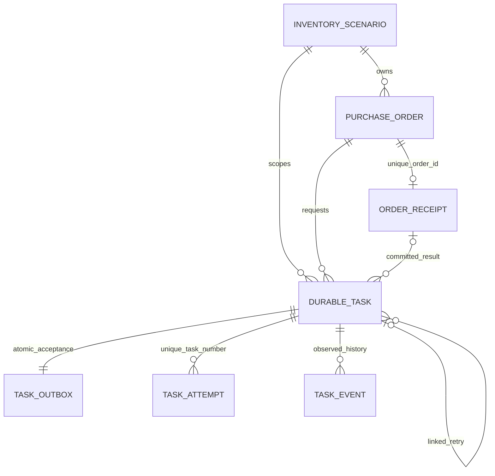

# Durable receipt task schema (0005)

Explicit owned business migration only. Previous lab_order seed and002databases unchanged. All timestamps are MySQL UTC DATETIME(6); API annotates database-naive UTC withZ. Exact totals DECIMAL(14,2), JSON snapshot immutable after first unique receipt creation.

Task UUID PK and payloadSHA enforce intent replay. CHECK bounds attempts/max1..5, fixedkind, validstate, running↔token/lease presence, succeeded↔receipt presence. FK deleteRESTRICT preserves history. Task scope/state/available and scope/state/lease indexes bound due scans; order FK indexed. Outbox next_publish index supports due selection. Attempt UNIQUE(task_id,number) prevents duplicate attempt identity; event(task_id,id) supports latest100 bounded inspection. Receipt UNIQUE(order_id) enforces one durable effect across tasks.

Task→Outbox lock order is explicit, one bounded XADD while locks held. Handler runs outside claim/finalizeSession. Final receipt upsert uses ON DUPLICATE KEY UPDATE id=id and current locked read, not INSERT IGNORE. Conditional Task UPDATE checks currenttoken/state/DBlease at mutation; rowcount≠1 rolls back inserted effect. Normal failure reschedules durable outbox before ACK. Failed is terminal; retry_of links a new successor. Crash finish and handler_ms unknown; separate abandoned_at records recovery observation. No create_all/startupDDL/reset.
