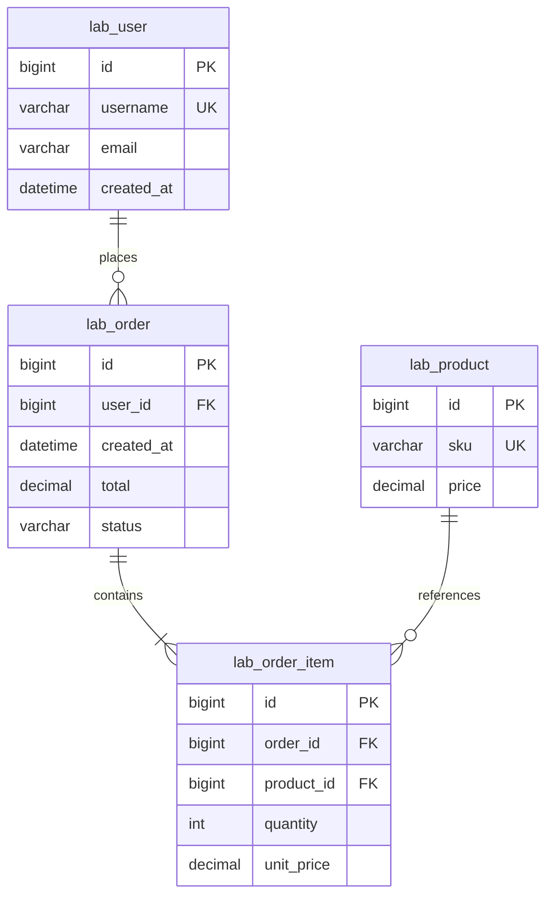

# 002 MySQL 索引与分页实验

这是数据库结构与 SQL 教学 Feature，无订单业务 API、Redis 缓存、库存或任务队列。
设计源：[Spec](../../../specs/002-mysql-index-baseline/spec.md)、[Plan](../../../specs/002-mysql-index-baseline/plan.md)。
实测汇总见 [report.md](report.md)，DBeaver 指南见 [dbeaver.md](dbeaver.md)，原始结果见 runs/。

## 当前 ER

完整字段/约束见 [data-model.md](../../../specs/002-mysql-index-baseline/data-model.md)。实验 ownership/dataset 两表仅作防误操作与数据身份追溯。UTC 无时区 DATETIME(6)，金额 DECIMAL(12,2)；明细使用历史单价，订单 total 与生成的两明细金额一致。

## 首次启动及安全边界
使用独立 mysql-experiment 实例，端口默认13306，单独 volume，不使用应用 MySQL 数据库。
.env 的 MYSQL_PASSWORD 默认也作为实验用户 lab_exp 密码；可用 EXP_MYSQL_PASSWORD 覆盖（设置后重建已有 volume 不会自动改密码）。账号仅授权固定实验数据库和只读 mysql.innodb_index_stats。
```powershell
uv sync --frozen
docker compose -f compose.yaml -f compose.experiments.yaml --profile experiments up -d --wait mysql-experiment
uv run python scripts/provision_index_lab.py
```
实验库 allowlist：concurrency_lab_exp_002_10000、_100000、_1000000、_test。脚本同时验证实际 DATABASE() 与 ownership purpose。首次 init 仅允许空数据库；seed 要求数据表和 manifest 为空，按批提交，中断保留 loading，拒绝自动续传。
没有 reset、truncate、delete 或 drop database 命令。不要为了重复实验对共享库执行手工清空。Alembic downgrade 是明确的 Schema 回滚命令，会丢失相关表数据，不能用作日常实验重置。

## 数据生成和测量命令
仓库 runs/ 包含已提交的实测证据，不能覆盖。你的新实验必须指定一个未使用的目录；下例为 runs/local-01。
```powershell
uv run python -m concurrency_lab.experiments.index_baseline --database concurrency_lab_exp_002_10000 --output-dir docs/experiments/002-mysql-index-baseline/runs/local-01 init
uv run python -m concurrency_lab.experiments.index_baseline --database concurrency_lab_exp_002_10000 --output-dir docs/experiments/002-mysql-index-baseline/runs/local-01 seed --orders 10000 --seed 20261023 --batch-size 1000
uv run python -m concurrency_lab.experiments.index_baseline --database concurrency_lab_exp_002_10000 --output-dir docs/experiments/002-mysql-index-baseline/runs/local-01 measure --phase baseline --repeats 7
uv run python -m concurrency_lab.experiments.index_baseline --database concurrency_lab_exp_002_10000 --output-dir docs/experiments/002-mysql-index-baseline/runs/local-01 optimize
uv run python -m concurrency_lab.experiments.index_baseline --database concurrency_lab_exp_002_10000 --output-dir docs/experiments/002-mysql-index-baseline/runs/local-01 measure --phase optimized --repeats 7
```
100000/1000000 对应替换库名和 --orders；也可以在三个新空库上一次验收：
```text
uv run python scripts/verify_index_lab.py --output-dir docs/experiments/002-mysql-index-baseline/runs/local-02
uv run python scripts/verify_index_lab.py --verify-only
uv run python scripts/verify_index_lab.py --verify-only --output-dir docs/experiments/002-mysql-index-baseline/runs/local-01 --orders 10000
```
--verify-only 校验已有 JSON，不连数据库，不执行造数。正式采样默认7次，单客户端预热后重复，SQL 使用固定 allowlist和绑定参数。
每规模1000用户/100商品、每订单两条明细，10k/100k/1m 订单分别为20k/200k/2m 明细。seed 固定、ID固定、批次摘要与 batch size 无关，内存与批大小成比例。生成吞吐仅是基础索引下批量写入，不代表索引前后写性能比较。

## 重复实验：保留原数据，建立独立环境
本机现有三个库已有数据，不能重新 seed。选择新的 Compose project 和端口，得到全新独立 volume，并使用新结果目录：
```powershell
$env:EXP_MYSQL_PORT='14306'
docker compose -p hcl-repeat1 -f compose.yaml -f compose.experiments.yaml --profile experiments up -d --wait mysql-experiment
uv run python scripts/provision_index_lab.py --project-name hcl-repeat1
uv run python scripts/verify_index_lab.py --orders 10000 --output-dir docs/experiments/002-mysql-index-baseline/runs/repeat1
```
Linux 使用 `export EXP_MYSQL_PORT=14306`；其余命令相同。结束可用相同 -p/-f 参数执行 stop 或 down，保留 volume，不执行 down -v。恢复原实例时移除临时 EXP_MYSQL_PORT 或设回13306。

## 实验定义与指标口径
- revision0002：保留 PK、unique、FK 支持索引，无 email/user+time/global time 专用索引。
- revision0003：新增 ix_user_email(email)、ix_order_user_time(user_id,created_at,id)、ix_order_time(created_at,id)。ORM metadata 为最终 head。
- 主键查询为对照；按用户过滤基线已有 FK 索引，不能宣称从完全无索引提升。邮箱查询展示真正的全表扫描，用户时间排序展示缺少合适排序索引的代价。
- OFFSET/keyset 使用 created_at DESC,id DESC。keyset 用 `created_at < :t OR (created_at=:t AND id<:id)`，验证同一深页ID一致。
- 游标通常来自上一页；实验为了比较相同深页，通过独立 OFFSET 获取游标并记录 cursor_lookup_ms。随机跳页仍需定位，不能把它算成免费的加速。
- EXPLAIN ANALYZE 真实执行，TREE 节点 actual time 是 ms，父节点包含子节点，不可相加；rows 是节点输出，loops为次数。扫描相关数为 scan/lookup 节点 rows*loops；不是物理磁盘读取量，也不是 LIMIT 根输出行数。
- DATA_LENGTH 是聚簇索引分配空间近似值，INDEX_LENGTH 是二级索引分配空间近似值；每索引页统计也为估算。exact counts 与 CHECKSUM TABLE EXTENDED 另采，保证基线/优化数据内容一致。
- P50/P95/P99 为客户端 wall ms 线性插值；7个样本不能可靠估计线上尾延迟。串行 QPS 非并发 API RPS；CPU/内存利用率未采样，JSON 为 null。环境保留 buffer pool/隔离级别/连接数。

## 测试
```powershell
uv run python scripts/verify.py
$env:EXPERIMENT_INTEGRATION='1'
uv run pytest tests/integration/test_index_baseline.py --basetemp .pytest_cache/index-tests
```
首次新测试库执行完整 pipeline，重复运行保留已有优化数据并显式跳过完整 pipeline，其余保护/约束/分页测试仍执行。CI 每次使用新实例，完整运行该测试。默认基础 integration 不启用实验测试，会明确 skip。

## 本阶段人工学习
1. PK 聚簇索引、二级索引与回表，外键支持索引为什么不能随意删除。
2. 联合索引最左前缀、过滤与排序的配合，覆盖索引如何避免回表。
3. estimated rows 与 actual rows/loops，LIMIT输出和底层访问行数的区别。
4. 稳定排序、OFFSET线性跳过、keyset边界，以及连续翻页与随机跳页的不同需求。
5. 批次事务、executemany、失败留下部分已提交数据，为什么不能宣称全量原子操作。
6. 数据分布、buffer pool、预热、统计信息和小样本噪声，为什么必须保留原始计划和未优化基线。

现有Feature在新克隆中恢复官方脚本上下文（PowerShell）：
```powershell
$env:SPECIFY_FEATURE_DIRECTORY='specs/002-mysql-index-baseline'
.specify/scripts/powershell/check-prerequisites.ps1 -Json -RequireSpec -RequireTasks -IncludeTasks
```
feature.json 是官方定义的本机状态，按官方规则忽略，不提交。
