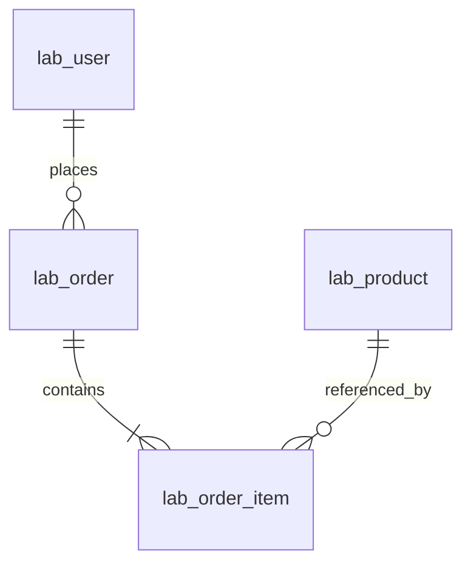

# 004：真实业务请求链路交付
2026-10-25。独立业务库，四类固定参数化读取：商品、用户订单、时间/ID分页和订单明细。无业务缓存或写订单。
## 调用链

## ER

## 实现及源码
api/routes/business.py映射HTTP；services/business_service.py协调事务和预算；repositories/两个文件负责SQL；db/business.py负责安全与统一执行/取数观测；observability/负责区间、请求ID和结构化日志；schemas/business.py定义DTO；main.py持有独立可选池。前端独立api/types/composable/tracecomponent/queryView，复用既有主题和错误模式。
DDL复用Alembic0001–0003，新数据库独立迁移。造数复用纯reference_rows/order_batches/digest_batch；不复用002安全CLI。详见[ADR0002](../../architecture/decisions/0002-business-lab.md)。
## 运行与实际证据
完整[初始化、运行、查询、分页和测试命令](../../guides/business-lab.md)。运行uv run python scripts/verify_business_lab.py保存新的不可覆盖实际请求记录。runs/内四次真实请求记录及business-query.png为实际页面；不是负载性能或P99证据。
本地40unit、9integration（4index opt-in skipped）、17Vitest、6EdgeE2E通过，37sourcefiles mypy及lint/build通过；003历史值和002原始记录保留。详细失败修复/审查/限制/PR状态见[验收](../../../specs/004-real-business-trace/validation.md)。
## 学习重点
Session与Engine的资源所有权不同；同Session不能并发复用；readtransaction也需结束释放连接；复合索引与稳定游标；固定JOIN避免N+1；池获取区间包含建连/preping；客户端SQL+fetch不等于数据库服务器时间；父子区间不能相加。当前没有并发吞吐结论，005再做Locust。
