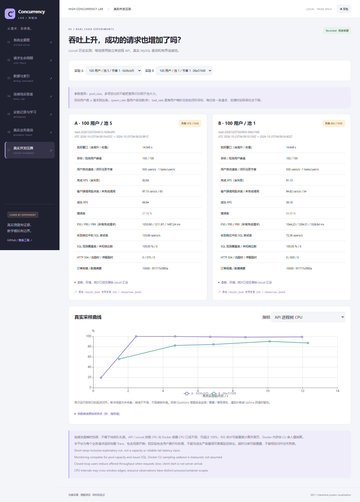

# 005：真实并发与连接池对比

2026-10-25顺序运行六组真实实验；参数请求15s，实际窗口含爬升和收尾，以每组manifest为准。独立单worker API，Windows11/Python3.12.14/Locust2.47.0/psutil7.2.2，Docker MySQL8.4.13，10000订单/1000用户/100商品，固定seed20261023。池max_overflow=0、pool_timeout=1s、业务请求预算5s。负载GET固定混合比例见[指南](../../guides/load-testing.md)。

全部工作负载源码在提交 `202cb16699a81ef15dee3b930680e162eba477cf` 冻结，运行前后校验SHA256 `40cdf1843ef3ee7a70714d491a6e633419cb1560fe4909b5a97c88edb55d412b`，dirty=false。数据digest均为 `5f1717c0f85ab7231d831f410262cebdbea96f751060f3343f6e7e95c0d80c34`。002数据库及记录未修改。运行时未并行执行数据库测试或构建。

|运行目录后缀|用户/池/节奏|实际秒|完成/失败|总RPS|成功RPS|错误率|P50/P95/P99 ms|
|---|---|---:|---:|---:|---:|---:|---|
|043724-36157455|10/5/1|14.108|140/0|9.924|9.924|0%|84.785/136.572/172.829|
|043748-432cad6f|50/5/1|14.151|700/0|49.466|49.466|0%|328.972/561.174/613.689|
|043812-fd36cbf5|100/5/1|14.566|1350/375|92.683|66.938|27.78%|1033.903/1211.967/1497.241|
|043836-ce20964b|500/5/1|18.018|2479/2227|137.585|13.986|89.83%|2443.616/8043.622/8592.153|
|043903-06e51fd9|100/1/1|14.649|1335/805|91.132|36.180|60.30%|1044.235/1294.506/1508.839|
|043927-23dcc67d|100/5/2|14.627|1430/619|97.766|55.446|43.29%|1083.538/1271.785/1598.175|

完整目录为 `runs/load-20261025T{目录后缀}/`。每个result.json含环境、完整精度、参数、原始Locust统计、资源快照和指标定义；同目录保存原始CSV/JSONL。表中RPS均以实际monotonic窗口计算，延迟包含失败请求，不代表成功请求独有延迟。闭环节奏单位为tasks/user/s，每任务一条请求；spawn_rate固定500users/s。

100用户控制对比：池5比池1成功RPS更高、池超时更少（375对805）；这只是此环境此负载下的一次短测，不能推出池越大越好。同样池5，节奏从1升到2，总RPS增加而成功RPS降低、错误率上升。500用户总RPS更高但成功RPS约13.99，不能把失败吞吐当作可用容量。

500用户失败分解：1645次HTTP503/pool_timeout，283次ConnectTimeoutError，239次ReadTimeout，60次ConnectionRefusedError。后面三类没有收到业务Trace；不能据此认定全部请求已到MySQL或全部由数据库导致。SQL观测覆盖率仅76.52%，其余组为100%。所有组HTTP504为0。超时维度可能重叠，原始status/error_code/error_type可复核。

客户端起点/完成/未完成分别为150/140/10、750/700/50、1415/1350/65、2547/2479/68、1389/1335/54、1489/1430/59。未完成可能涉及停止/取消，不计入完成请求错误率；这是记录边界，不将其补成成功或失败。Locust请求15s与实际窗口不同，按真实test_start至quitting测量，不强行写成15秒。

资源采样每组保存25..35个不同scope快照；API/Locust CPU与RSS、Docker MySQL/Redis CPU/MEM、业务池及MySQL全实例连接/语句计数分别标记。采样受监测SQL、池等待和Docker CLI成本影响，不能假设等间隔；曲线使用实际elapsed_s。MySQL Questions不是纯业务QPS，收到Trace中的SQL尝试率亦不是服务端完整QPS。

早期探索记录原样保留在本地ignored `.pytest_cache/load-exploratory-005/`；它们用于发现CPU基线缺口，不纳入此对比。正式数据使用修复后冻结源码重新采集，无修改历史数值。

运行入口见[指南](../../guides/load-testing.md)，设计见[ADR0003](../../architecture/decisions/0003-load-evidence.md)，验证见[005验收](../../../specs/005-real-load-testing/validation.md)。短窗口、单次实验、完整Trace、同主机负载器及Docker Desktop资源口径均限制结论，不能作为生产容量承诺。

