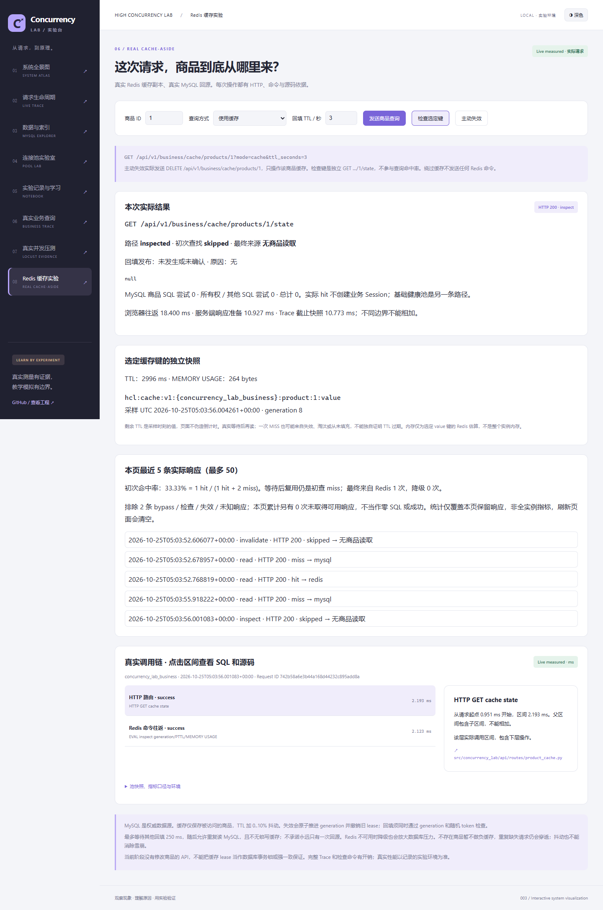

# 006：Redis 商品缓存真实实验

最终验收记录：[cache-20261025T050337-76199f7c/result.json](runs/cache-20261025T050337-76199f7c/result.json)。UTC2026-10-25 05:03:37.670432 →05:03:40.063005，实际2.393s，含真实TTL等待。代码checkpoint `01efe1aa1290b4e751621e734f4046bc211963b6`，本地工作负载源码clean，摘要 `07abe419123c2950b5760e5c149efc8f6aa509e01b7738e82179ad055698a894`，前后校验一致。API已按该源码重启；记录明确说明服务器revision未通过HTTP独立认证。

Python3.12.14、redis-py7.4.1，业务监测返回MySQL8.4.13；补充容器二进制检查 `docker compose exec -T redis redis-server --version` 返回Redis7.4.11。单worker API，业务池5/max_overflow5，池超时1s，请求预算5s，Redis客户端默认最多10连接。数据为既有owned business-lab-v1：10000订单、seed20261023、digest `5f1717c0f85ab7231d831f410262cebdbea96f751060f3343f6e7e95c0d80c34`。

|真实请求组|完成数|初查hit/miss|商品SQL尝试|全部SQL尝试（含归属）|客户端P50/P95/P99 ms|
|---|---:|---:|---:|---:|---|
|绕过缓存|5|不参与|5|10|27.561/61.469/68.243|
|冷读|1|0/1|1|2|35.628/35.628/35.628|
|热读|5|5/0|0|0|19.609/20.643/20.714|
|等待TTL后读取|1|0/1|1|2|34.374/34.374/34.374|
|主动失效后读取|1|0/1|1|2|35.935/35.935/35.935|
|清除选定缓存后并发发起|6|5/1|1|2|123.135/135.891/135.905|

每次响应和真实Trace均保存在JSON observations，金额副本一致为字符串1.17。热读没有业务Session或MySQL商品查询；cache bypass不发送Redis命令。整体18条返回SQL尝试包括9条商品查询和9条所有权检查，未用“请求数×预期SQL数”填表。

并发组是6个客户端协程同时发起请求，不能据此宣称服务端6次初查都MISS。本次实际初查为1MISS+5HIT，只有1次回源。另有真实集成测试通过受控暂停证明首查MISS的等待者可复用Redis，以及协调deadline后允许重复回源；这些测试用来证明规则，不作为性能测量。

TTL检查实际记录剩余934ms、value键MEMORY USAGE264bytes；真实等待后PTTL=-2、内存null（键不存在）。随后读取MISS并重新回源。此处记录观察序列，没有伪造Redis keyspace过期事件。MySQL全实例Questions前后增加39，包含事务/监测和其他实例活动，不能替代业务SQL次数或称纯业务QPS。

先前checkpoint记录 [cache-20261025T050032-ade1e462](runs/cache-20261025T050032-ade1e462/result.json) 原样保留；审查修正“损坏generation不等于Redis连接丢失”后，重新启动API完成上述最终记录。没有修改旧记录或002/005原始证据。

限制：每组仅1..6次请求，分位数用于可复核展示，不足以估计稳定尾延迟或容量。完整Trace、单机客户端、检查与监测均有开销。Redis服务器版本为补充容器检查，HTTP记录未独立认证服务端源码。缓存失效、租约和TTL不构成MySQL/Redis强一致事务。不存在商品目前不缓存，因此会穿透；有界协调不保证恰好一次回源；抖动不能消除雪崩；Redis失效降级可能放大数据库压力。分析和取舍见[ADR0004](../../architecture/decisions/0004-product-cache.md)。

运行命令与学习步骤见[指南](../../guides/cache-lab.md)，测试/审查见[验收记录](../../../specs/006-redis-cache-aside/validation.md)。

