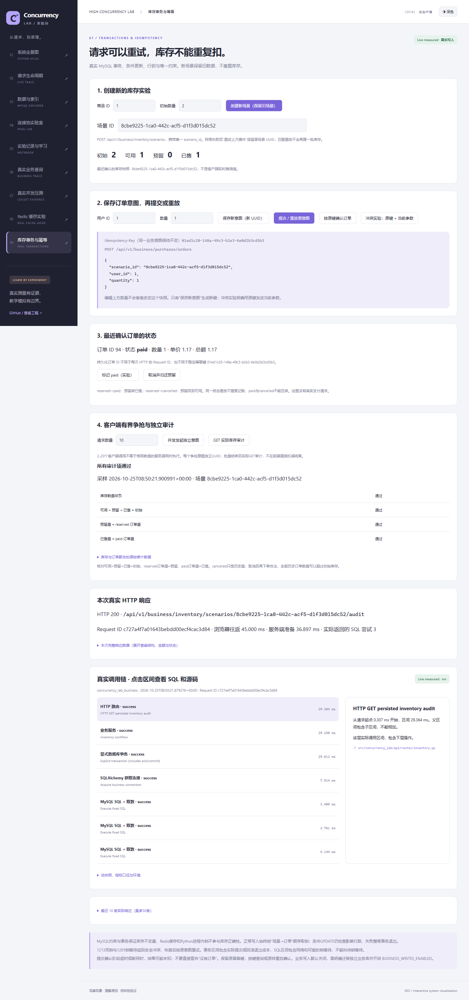

# 007：真实库存竞争、事务与幂等验收

最终记录：[inventory-20261025T084847-713d2807/result.json](runs/inventory-20261025T084847-713d2807/result.json)，complete=true，实际窗口2.304s。源码checkpoint `2984f423556e2d56049a920283da42356f78806e`、clean，SHA256 `0d1d332c8d1646c76bd25562f94632397d218d926247283aaf9228a32eaacc36` 前后相同。共41次库存HTTP响应（其中3次持久化审计），另有2次独立环境监测；服务器revision未通过HTTP独立认证。旧的首次功能记录 [inventory-20261025T083659-524fdafe](runs/inventory-20261025T083659-524fdafe/result.json) 原样保留。

环境由真实监测/Trace记录：MySQL8.4.13，Python3.12.14，单worker业务池5/max_overflow5、池超时1s、请求预算5s、session行锁等待1s；owned business-lab-v1基线10000订单、seed20261023。新场景/订单只写0004表，不改lab_order或Redis；002/005/006原始记录保留。

|实际步骤|真实结果|
|---|---|
|20个不同UUID意图，初始库存5|5个201新订单，15个409 insufficient_stock；可用0/预留5/已售0|
|同键改quantity|409 idempotency_conflict，没有额外预留|
|取消一个订单并重复取消|第一次归还1，第二次no-op|
|支付另一个订单，随后取消|支付成功，取消返回409 invalid_order_transition|
|将归还的1份再次预留|新建1单成功；可用0/预留4/已售1|
|新场景库存1，同一UUID并发10次|1个201、9个200重放，全部同一order ID；只预留1|
|三次独立GET审计|非负、余额、reserved聚合、paid聚合均true|

第一个场景最终历史订单为reserved4、paid1、cancelled1，总数6超过初始5是合法的取消后再预留，不能据此判断超卖。正确核对的是当前预留与已售，占用合计仍为5。

真实测试另外构造了：CHECK3819拒绝负数/失衡/错误金额，FK失败后按键404且库存未变；两个RR旧快照同键竞争、售罄后仍能重放；20不同键不超卖；paid/cancelled竞争只应用一次；外部行锁触发1205后整事务回滚并恢复。外部反序事务实际触发1213，本地专项运行输出 `Actual MySQL1213 deadlock victim: api`，API安全409后重试成功。测试不假设所有环境固定受害者，正常代码不使用反序。

取消测试暂停在真实条件更新之后、提交之前，取消任务后证明订单不存在且库存恢复；它不证明提交ACK超时必然回滚。ACK或网络未知时，按原键确认/重放，这是不同边界。

这些是小规模正确性验收，不是生产容量或可靠P99结论。客户端并发发起数不等于服务端同时执行数；Trace与锁等待成本包含在记录区间内，未伪造纯锁等待。所有失败码、Request ID、原意图与SQL均可在JSON复核，不用HTTP200个数代替业务不变量。

操作与命令见[库存指南](../../guides/inventory-lab.md)，结构见[ER](../../database/inventory.md)，审查/测试见[验收](../../../specs/007-inventory-idempotency/validation.md)。核心学习：事务整体回滚、条件更新、固定锁顺序、RR与current read、唯一约束、幂等键和payload快照、提交结果不确定、按状态对账。

最终修订显式指定每个库存事务REPEATABLE READ，真实测试先把会话改成READ COMMITTED，再在审计事务内查询确认RR。补充环境的中间记录inventory-20261025T084051-009417dc也原样保留；上述最终记录在重启2984f42源码后重新执行。
