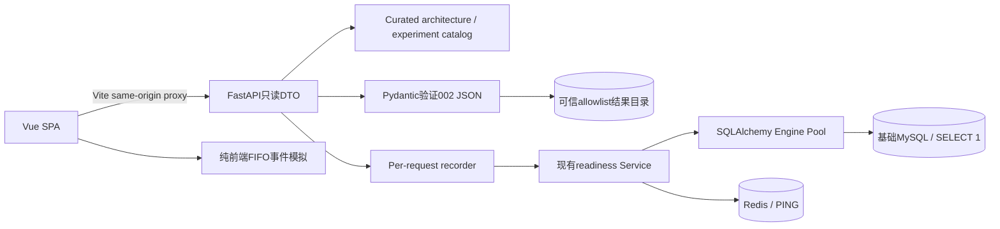

# 交互式系统可视化平台（003）

本地后端工程学习入口，不是商城前端或生产监控。五类页面：系统全景图、HTTP生命周期、MySQL数据/索引、连接池实验室、实验记录与详情。

## 启动
要求 uv、Docker/Compose、Node22.13+或24、npm。实际版本固定在 uv.lock/package-lock.json，安装使用 frozen/npm ci。
已有 .env 请保留；新克隆复制 .env.example并填写本地密码。仓库不包含真实密码。
```powershell
cd D:\Digital_Life\02_Projects\03_HOU\high-concurrency-lab
uv sync --frozen
docker compose up -d --wait
uv run uvicorn concurrency_lab.main:app --host 127.0.0.1 --port 18002
```
另开终端：
```powershell
cd D:\Digital_Life\02_Projects\03_HOU\high-concurrency-lab\frontend
npm ci
npm run dev -- --host 127.0.0.1 --port 5173
```
打开 http://127.0.0.1:5173/ 。Linux进入对应克隆目录执行同样命令，不使用Windows cd路径。端口已占用时选其他端口并设置 API_PROXY_TARGET 为实际后端地址（PowerShell `$env:API_PROXY_TARGET='http://127.0.0.1:18002'`；Linux `export API_PROXY_TARGET=...`）。Vite开发代理同源转发，不配置通配CORS；生产部署不在本Feature范围。
002页面读取仓库内已测JSON，无需重新生成数据或启动13306实验MySQL。Live Trace实际检查基础应用MySQL和Redis；基础服务端口由.env决定（本机3306/16379），与13306实验实例区分。

## 页面与交互
| 路径 | 功能 | 来源 |
|---|---|---|
| / | VueFlow缩放/拖动/选中；职责、输入输出、瓶颈、验证及源码；初始化记录 | 实际代码拓扑/实际lazy创建事件 |
| /trace | 采集真实健康请求、事件选择、单步/播放/暂停/重置；切换概念模拟 | Live Trace和Simulation分别标记 |
| /database | 三规模/六SQL；ECharts P50/P95/P99对照、访问行数/空间/游标成本；可展开树、原始SQL/参数/TREE/JSON | 002原始不可变记录 |
| /pool | 参数控件、容量槽位、FIFO队列、借还/超时、逐帧回放；真实池快照 | Simulation / live snapshot各自独立 |
| /experiments及/experiments/002-mysql-index-baseline | 观察-问题-假设-参数-验证-解释-局限的实验笔记 | 002报告及源码引用 |
左侧导航、浅/深模式、加载/空/错误重试；路由按需加载，ECharts按需导入，图表容器ResizeObserver并在卸载dispose。当前无需Pinia：共享仅限播放composable与页面内状态。

## 实际架构

当前health不经过ORM Session，图中Session为已定义的教学旁路。Redis健康检查已接入，业务缓存未实现，不能把虚线路径当作真实调用。

## API（只读）
- GET /api/v1/architecture：固定节点/边、源码和本次进程初始化事件。
- GET /api/v1/experiments：固定实验清单。
- GET /api/v1/experiments/002-mysql-index-baseline：实验学习详情。
- GET .../results?scale=10000|100000|1000000：经过Schema校验的Baseline/Optimized及来源。
- GET .../query-plans?scale=...&phase=baseline|optimized&query=primary_key|by_user|user_time|offset|keyset|email：原始计划、树、SQL、绑定参数。
- GET /api/v1/observability/health-trace：实际健康调用的结构化事件，健康200、失败503仍返回Trace DTO。
- GET /api/v1/observability/pool：瞬时configured size/max overflow/checked out/current overflow；waiting/pure_wait_ms=null。
旧 /health/live 和 /health/ready不变。未知实验404，非法规模/枚举422，可信结果缺失/损坏503且不泄漏内部路径。没有文件下载任意路径、SQL输入或数据库写入API。

## 观测可信边界
1. 后端perf_counter：handler进入→service进入→两探针开始/完成→service结束→response准备。每事件明确来源/状态，offset为同一请求handler起点的相对ms。
2. probe区间包含获取连接、可能的pre-ping、命令和关闭；未单独采集纯pool_wait、建连、SQL或Redis命令耗时。不能把它命名为纯排队/SQL时间。
3. Router已匹配后handler才开始记录，不能推断路由匹配耗时；response准备不等于已经传完字节。
4. 前端performance.now围绕fetch及JSON读取，单独添加浏览器发起/读取完成事件。浏览器与服务端时钟不相减，span并发/重叠也不求和。
5. 启动事件是真实的lazy对象创建，不是连接数据库成功的证据。真实池是手动刷新的瞬时gauges，非连续采样、非吞吐/等待时间。
6. 单步/播放是回放已采集的事件，不会暂停或单步控制真实数据库操作；第一版不做流式事件推送。
7. Simulation预设Trace与池模拟有显著标签，所有虚拟时间是模型值；回放650ms间隔是教学速度，不是实际耗时。实际数据页是Recorded measurement，不称为当前数据库现场指标。

## 池模拟规则
所有请求t0到达；容量size+overflow，FIFO、不抢占、固定SQL占用时长。离散事件推进至最近归还或等待截止；同刻先归还/分配再处理仍等待的超时。计时到SQL开始前为排队，开始后不受pool_timeout影响。输入限制请求1..50、size1..10、overflow0..10、timeout/duration100..10000ms。
槽位显示容量上限，不代表SQLAlchemy实际预建连接。模拟无网络、DB锁/IO、连接创建与系统调度，不能作为性能测量或真实池调参依据。

## 证据与数据安全
002JSON不修改/不重造，固定实验ID/规模/阶段/查询allowlist，路径resolve后检查containment并限制2MB；schema_version/phase/revision/dataset/sample count/query set/storage fields均验证。返回相对仓库来源与GitHub链接，不返回服务器磁盘路径。Trace不记录配置、DSN或异常文本。
Docker后端镜像包含同一份002证据，CONCURRENCY_LAB_ROOT=/app指定可信根。若单独安装wheel到其他位置，需要由管理员设置CONCURRENCY_LAB_ROOT指向含docs的可信项目根；API不能修改此配置。
原始样本仅7次、暖缓存、单客户端；P95/P99为小样本插值，不代表线上尾延迟。访问节点输出行数不是物理IO；表/索引为页分配估算；游标定位成本不可忽略；CPU/内存未测值保留null。

## 检查与端到端验收
```powershell
uv run python scripts/verify.py
uv run python scripts/verify_index_lab.py --verify-only
uv run pytest tests/integration
cd frontend
npm run check
npm run test
npm run build
npx playwright install chromium
npm run test:e2e
```
Playwright自动启动独立前端5174和后端18002（本地已有服务会复用；CI不复用）。需Docker基础依赖healthy和根目录.env有效。Windows本机可复用已安装Edge：`$env:PLAYWRIGHT_CHANNEL='msedge'` 再执行 test:e2e，避免重复下载Chromium；CI安装官方Chromium。Node22与24均为测试环境之一。
E2E主流程使用真实API和数据库健康探针，不Mock结果；另外单独的错误测试注入503验证重试UI。截图见 [架构](../experiments/003-interactive-system-visualization/architecture.png)、[数据页](../experiments/003-interactive-system-visualization/database.png)、[Live Trace](../experiments/003-interactive-system-visualization/live-trace.png)。

## 已知限制和下一步
不是分布式追踪平台；无Router匹配/网络传输/纯队列等待的独立精确计时，无池等待人数时间序列。客户端Schema在关键投影处检查，后端Pydantic是完整证据校验边界。
前端整包ElementPlus及图表vendor块仍可能触发Vite大chunk警告；已按路由/图表功能拆分，暂不以牺牲教学清晰度引入复杂打包配置。没有生产静态托管、鉴权、Prometheus/Locust或OpenTelemetry部署。
后续独立Feature：Locust真实负载结果适配RecordedResult；Prometheus新增时间序列DTO与采样间隔/单位/来源，不复用Simulation DTO；若测pool acquire须区分排队/建连/pre-ping，保留source/evidence和观测局限。先建立基线，再增加指标，避免把采集时间混入业务SQL时间。

## MySQL 与 Redis 从哪里看起
首页顶部提供两种存储的内容对照：MySQL 关系表是权威数据，Redis 商品键值是示意副本。默认健康场景按实际代码展示并发 SELECT 1 / PING，不代表已经实时采集。通过下一步、上一步、重新演示查看命令和访问目标。首次读取、命中、过期三个场景都是独立的纯前端 Simulation，切换重置步骤；示意商品42不来自真实实验库。缓存60秒是示意设置，不是倒计时。当前没有业务缓存、命中率或缓存性能测量；真实健康采集仍在请求生命周期页，真实索引数据仍在数据与索引页。缓存失效与并发一致性需后续单独实验。参考 [Redis官方Cache-Aside](https://redis.io/docs/latest/develop/use-cases/cache-aside/)。

## 具体请求、目标与探针结果
首页“请求到底发到哪里”可展开完整教程，请求生命周期页默认展开。采集按钮发送 GET /api/v1/observability/health-trace，无请求体，经Vite同源代理进入health_trace，再调用readiness。教程通过GET /api/v1/observability/probe-guide读取当前应用数据库名、Redis逻辑库0和三个超时预算，不暴露账号、地址、密码或连接串；此配置接口不会执行探针。
MySQL用共享Engine借连接执行SELECT 1，不读业务表、也不经过Session；正常执行及退出连接作用域就返回True，不读取并比较标量。Redis用共享客户端执行PING，redis-py将PONG解析为True，不访问商品键。每项外层asyncio.timeout预算独立，连接/命令/池超时可更早失败。两个探针通过asyncio.gather并发执行，失败一个不跳过另一个，最后两个都ok才返回200，否则503。未知区间仍不拆造性能数值。
/health/live完全不连接依赖；/health/ready与trace复用相同检查，但不返回事件列表。索引结果HTTP接口读取002持久化JSON，不在当前请求重跑实验；百万数据当时来自concurrency_lab_exp_002_1000000，与当前健康检查的应用库区别展示。
真实追踪采集完成后，结果卡显示两个checks，展开完整服务端响应；这些完成结果与动画回放位置分开。教学模式可以选两项成功、MySQL异常、Redis异常、MySQL预算超时，逐步查看；全部是纯前端假设，不停止容器、不注入真实故障、不展示预设毫秒。真实接口把异常与超时统一为unavailable，不返回原因；教学中的认证/连接原因仅是假设。HTTP503是后端已经回应但依赖不就绪；Failed to fetch表示未取得可读响应，不能说数据库探针一定跑过。
验收使用mock失败/超时的服务端单元测试与浏览器响应夹具（明确非实际故障证据）；本机真实成功探针另行记录。
