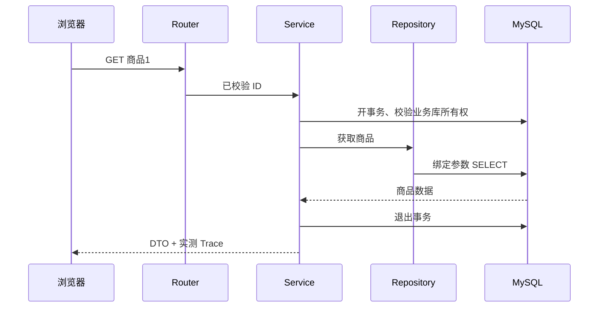

# 01 一次请求：先找到责任，再看代码

## 问题与解释

浏览器发 `GET /api/v1/business/products/1`，不是“前端直接查 MySQL”。前端向 API 发 HTTP；API 校验商品 ID，Service 开始读事务，Repository 发绑定参数的 SQL，DTO 把结果变成约定 JSON。MySQL 用户和端口由后端配置决定，浏览器不持有数据库密码。

Router 像接待台，知道 HTTP；Service 像办事流程，决定先后；Repository 只知道如何存取；Domain 是独立业务规则。例如“已取消订单不能再支付”不依赖 FastAPI。“返回409”则属于 HTTP 映射。这种划分让你改规则时不用同时改 SQL 和页面。

本项目借鉴 Cosmic Python 的职责思想，但不照搬其整套架构。一个函数能表达清楚的规则，不必建策略工厂、抽象基类、注册器。新的一层应当有真实责任，不能只是转调下一层。



HTTP 状态用于表达请求结果：200读取成功、201新建、422参数不合约、503当前不可用。冲突、缺货等具体状态查看项目错误映射，不能把所有异常都包装成200。TCP 负责字节运输，HTTP 约定方法/路径/头/正文；访问本机 IP 不需要域名解析，本地 HTTP 也没有 TLS。部署域名 HTTPS 才多出 DNS、证书与 TLS 链路。

## 源码入口

按顺序读 [路由](../../src/concurrency_lab/api/routes/business.py) 的 get_product、[业务服务](../../src/concurrency_lab/services/business_service.py)、[商品仓储](../../src/concurrency_lab/repositories/product_repository.py)、[DTO](../../src/concurrency_lab/schemas/business.py)。[中间件](../../src/concurrency_lab/observability/http.py) 关联 request_id；不要把它的响应头准备时间当浏览器完整耗时。

## 动手操作

先运行 `uv run pytest tests/unit/test_business.py -q`。配置好本地业务环境后执行：

```powershell
curl.exe -i http://127.0.0.1:18002/api/v1/business/products/1
curl.exe -i http://127.0.0.1:18002/api/v1/business/products/0
```

端口以你实际启动的 API 为准；未启动时依[业务指南](../guides/business-lab.md)操作，不临时开启所有写接口。

## 预期现象

业务模式开启且数据 ready 时，第一个返回商品、Trace 和 request_id；第二个参数校验失败，应该在查询商品前被拒绝。业务模式关闭时会503，而不是假商品。Trace 中 ownership SQL 也计数，商品主键查询不是整个请求唯一的 SQL。

## 反例

在 Router 里开事务、拼 SQL、查 Redis，能工作一阵，但无法单独修改业务顺序。另一个反例是客户端传 user_id 就相信“这是当前登录人”：参数存在不证明身份，第8章会解释。

## 自测与答案

问：为什么 Repository 不决定返回404？答：同一个查询可供 CLI/worker 使用，HTTP 不是持久化职责。

问：HTTP200是否代表数据库写入过？答：不代表；GET可以只读，缓存命中甚至不访问 MySQL。要看实际调用链。

## 精选参考

[Cosmic Python Repository](https://www.cosmicpython.com/book/chapter_02_repository) 阅读职责与测试边界即可；[MDN HTTP Overview](https://developer.mozilla.org/en-US/docs/Web/HTTP/Guides/Overview) 用于查请求/响应概念。
