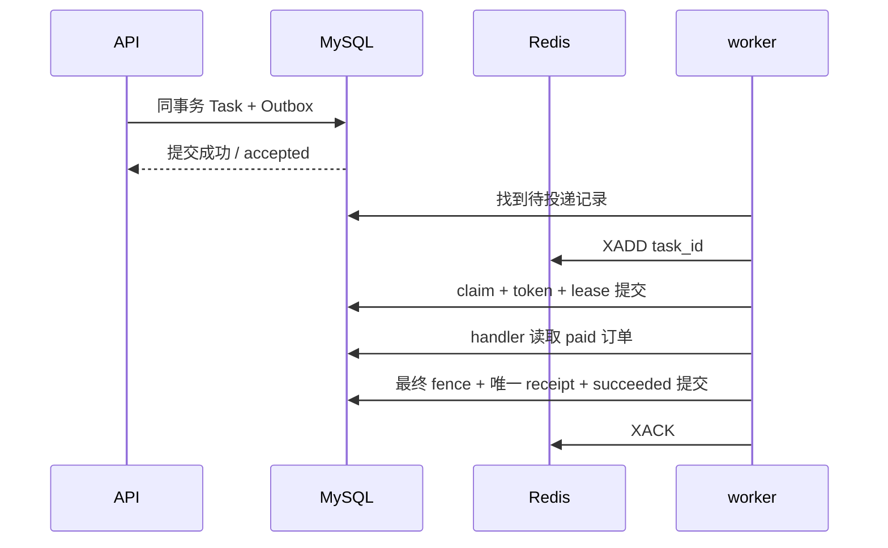

# 06 可靠任务：受理、执行、效果、ACK 是四件事

## 问题与解释

API 返回任务已受理，只说明 MySQL 中的 Task/Outbox 已提交，不代表回执生成成功。Outbox 是同一事务里的“待发送记录”：即便 Redis 当时不可用，发送意图还在，dispatcher 可以补发。Redis Stream 运输任务 ID，任务状态与回执事实留在 MySQL。

worker 领取任务时持有 token 与数据库 UTC 租约，先提交领取，再执行 handler。结束时在事务中再次检查 state/token/lease，写唯一 receipt 和终态，提交后才能 ACK。lease 是临时工作资格，fence 是最终写入时挡住过期资格的检查。只领取时检查一次不够，旧 worker 可能卡住后恢复。



如果最后 ACK 丢了，会再收到同一任务；终态判断与 `UNIQUE(order_id)` 阻止再次产生回执。这里是可重复投递配合幂等业务效果，不能说“消息只执行一次”。如果领取后进程退出，租约到期再恢复；旧 attempt 留下 abandoned，无法观测的完成耗时保持未知。

失败策略单独放在 `failure_decision`：非法 paid 订单不自动重试；其他原有失败在次数未耗尽时等待0.2、0.4、0.8、1.6秒，第五次失败终止；公式有2秒上限。终态记录仍保留原 due 字段，但状态阻止继续执行。重试不是立即递归调用 handler，更不能持着事务连接睡到下次。

## 源码入口

[失败决策](../../src/concurrency_lab/domain/tasks.py)、[受理](../../src/concurrency_lab/services/tasks.py)、[投递](../../src/concurrency_lab/workers/dispatcher.py)、[领取/执行/最终提交](../../src/concurrency_lab/services/task_execution.py)、[消费与ACK](../../src/concurrency_lab/workers/runtime.py)。先画提交边界，再逐个读函数。

## 动手操作

```text
uv run pytest tests/unit/test_learning_policies.py -k "failure or attempt or precondition" -v
```

按[worker指南](../guides/worker-lab.md)准备0005测试库与Redis，设置 `$env:TASK_INTEGRATION='1'`，执行：

```text
uv run pytest tests/integration/test_tasks.py -k "success_duplicates or child_crash or ack_failure" -v
```

测试使用新场景；不要对现有 failed 任务改库重置。手动重试创建 linked successor，保留旧历史。

## 预期现象

实际 child crash 用例会退出子进程再恢复；重复投递不产生第二份回执；过期 token 即便执行成功也不能提交最终效果。观察 Task、Attempt、Receipt、Outbox，而不是只看队列长度。XLEN 是保留流条目量，不等于未处理任务数。

## 反例

先ACK再提交可能丢工作；先commit后ACK会有重复窗口，必须靠幂等效果处理。把 `except Exception` 全部重试，既掩盖程序错误也可能重试永久业务失败；本项目只按明确分类处理，不吞取消。

## 自测与答案

问：只有 Redis Streams 的 pending 是否足够证明订单处理正确？答：不够，事实还需 MySQL状态、receipt和事务校验。

问：为什么 handler 中的延迟不持有 Session？答：睡眠不需要占数据库连接，也不应长期持锁。

## 精选参考

[Celery Tasks](https://docs.celeryq.dev/en/stable/userguide/tasks.html) 只比较幂等、retry、ack 的问题；Celery有自身终止/ACK细节，不能把其配置名当本项目保证。
