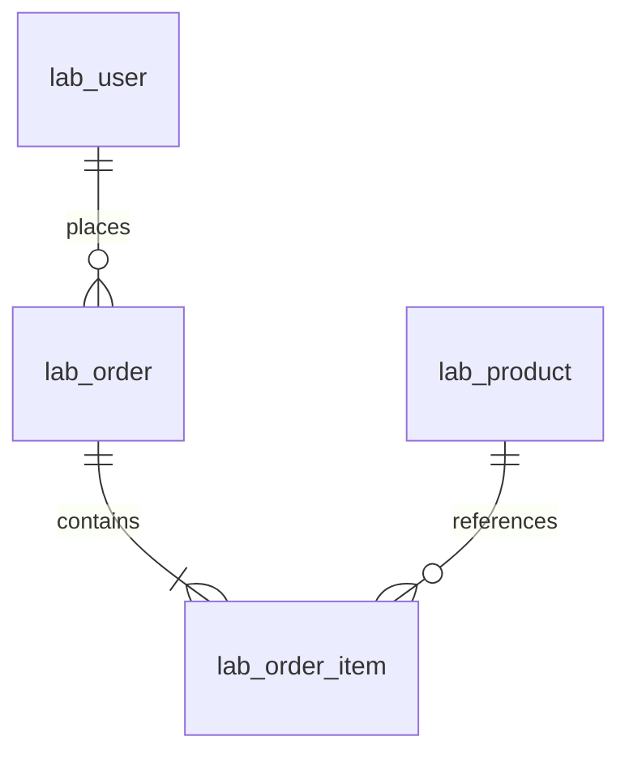

# Data Model and ER

- lab_user: id BIGINT PK, username VARCHAR(64) unique, email VARCHAR(128) nonunique (intentional baseline), created_at DATETIME(6).
- lab_product: id BIGINT PK, sku VARCHAR(32) unique, name VARCHAR(128), price DECIMAL(12,2) check >=0.
- lab_order: id BIGINT PK, user_id FK RESTRICT, created_at DATETIME(6), total DECIMAL(12,2) check >=0, status VARCHAR(16) check IN ('created','paid','cancelled'); explicit ix_order_user(user_id).
- lab_order_item: id BIGINT PK, order_id/product_id FK RESTRICT, quantity integer check>0, unit_price DECIMAL(12,2) check>=0; unique(order_id,product_id); index product_id.
- experiment_ownership: id integer PK=1, purpose VARCHAR(64), seeded by baseline migration as index-baseline-v1.
- experiment_dataset: id integer PK=1, seed BIGINT, order_count BIGINT, digest VARCHAR(64), status VARCHAR(16) loading/ready; no business API.
Optimization indexes: ix_user_email(email), ix_order_user_time(user_id,created_at,id), ix_order_time(created_at,id). Ascending B-tree can scan backward for both DESC columns. ORM metadata represents head; baseline intentionally lacks three optimization indexes.
